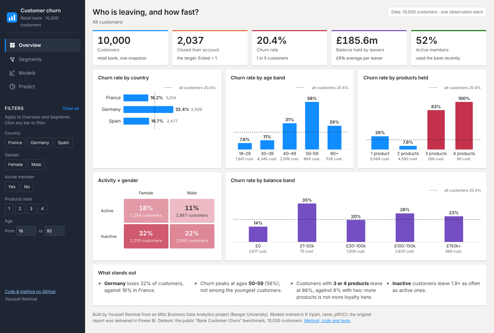
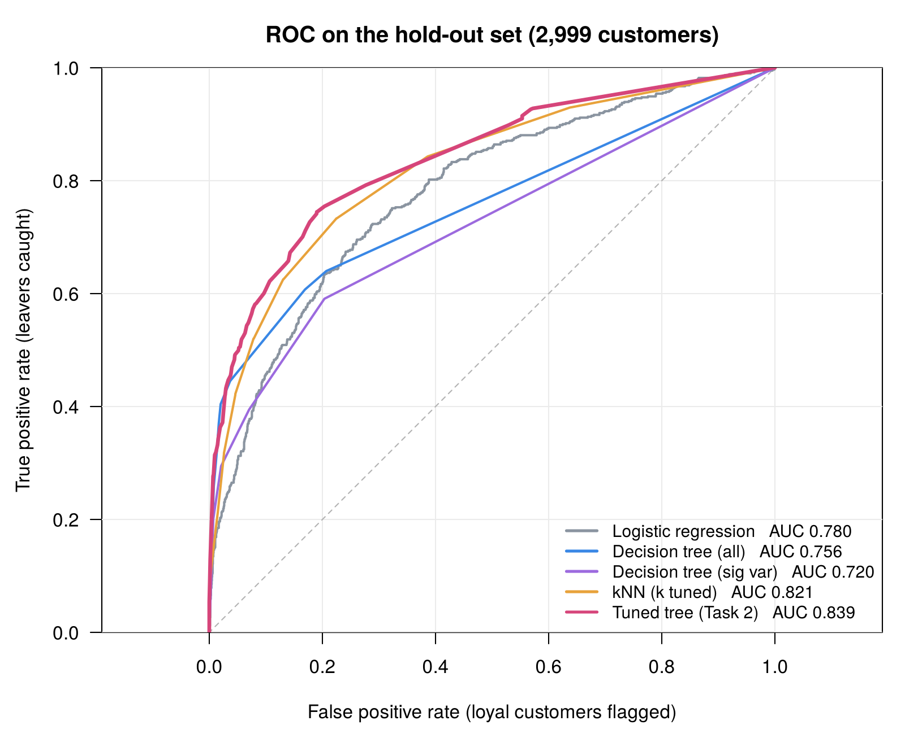
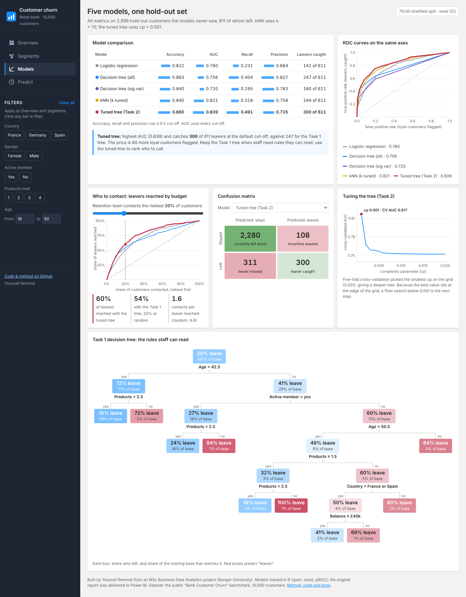

# Bank Customer Churn

**Which customers are about to close their account, and who should the retention team call first?** A churn project for 10,000 retail bank customers. It covers exploratory analysis, five classification models compared on one hold-out set, k-means customer segments, a Power BI report with native DAX scoring, and a browser version anyone can open.

[](https://github.com/Youssef-Remmal-tech/bank-customer-churn/actions/workflows/ci.yml)
  

**[Open the interactive report](https://youssef-remmal-tech.github.io/bank-customer-churn/)** · **[Power BI report](powerbi/README.md)** · **[Model results](outputs/tables/model_comparison.csv)**

Originally completed for the MSc Business Data Analytics Data Science module at Bangor University, where it received a Distinction. This repository rebuilds the work as a reproducible project and fixes the one defect found in review.



---

## The answer in 30 seconds

- **One in five customers left (20.4%).** Between them they held **£185.6m** in balances.
- **A retention team that contacts the riskiest 20% of customers reaches 60% of the people who will leave.** That is three times what random selection reaches. It takes 1.6 contacts per leaver found, against 4.9 at random.
- **The tuned decision tree is the best ranker** (AUC 0.839) and catches **300 of 611** leavers at the default cut-off, against 247 for the simpler tree. The cost is 60 more loyal customers flagged.
- **The risk is concentrated.** Customers aged 50–59 leave at 56%, German customers at 32% (against 16% in France), and inactive customers at 1.9 times the rate of active ones.
- **More products is not more loyalty.** Customers with three or four products leave at 86%, against 8% for those with two.

## Business problem

Keeping an existing customer is cheaper than winning a new one, but retention offers cost money. Every incentive given to a customer who would have stayed anyway is wasted, and every leaver who is missed is lost revenue. The bank needs two things:

1. **A ranking** of customers by risk, so a limited retention budget goes to the right people.
2. **Rules the back office can read**, so staff can see why a customer was flagged and explain the decision.

The project builds both, compares them honestly, and puts them in front of the people who use them in a report they can filter and query.

## Data

10,000 customers from the widely used public *Bank Customer Churn* benchmark (provided for the module as `BangorBank_Customers.csv`). One row per customer with credit score, country (France, Germany, Spain), gender, age, tenure, balance, products held, credit card, activity flag and estimated salary. The target is `Exited` (1 = closed the account).

| Check | Result |
|---|---|
| Missing values | none |
| Duplicate customers | none |
| Implausible ages or credit scores | none (age 18–92, score 350–850, all retained) |
| Identifiers | `RowNumber`, `CustomerId` and `Surname` dropped before modelling |
| Class balance | 20.4% leavers. The split is stratified so both sets keep that rate |

The raw file is checked against a SHA-256 checksum every time the pipeline runs.

## Approach

```
data/raw/BangorBank_Customers.csv
        │
R/01_prepare.R      clean, type categories with fixed factor levels, validate
        │
R/02_models.R       70/30 stratified split (seed 123), then:
        │             • logistic regression (baseline, picks inputs for the reduced tree)
        │             • decision tree, all inputs (Task 1 choice: readable rules)
        │             • decision tree, significant inputs only
        │             • kNN, centred and scaled, k tuned by 5×10 repeated CV
        │             • tuned tree: cp chosen by 5-fold CV on ROC (Task 2)
        │
R/03_segments.R     k-means (k = 3, elbow method, 25 starts) on six standardised fields
        │
R/04_export.R       ROC chart, tables, model files, and docs/data.js for the live report
```

## Results

All metrics are on the 2,999 hold-out customers the models never saw (611 leavers). Accuracy, recall and precision use a 0.5 cut-off.

| Model | Accuracy | AUC | Recall | Precision | Leavers caught |
|---|---|---|---|---|---|
| Logistic regression | 0.822 | 0.780 | 0.231 | 0.684 | 141 |
| Decision tree, all inputs (Task 1) | **0.863** | 0.756 | 0.404 | **0.837** | 247 |
| Decision tree, significant inputs | 0.840 | 0.720 | 0.295 | 0.783 | 180 |
| kNN (k = 13) | 0.840 | 0.821 | 0.318 | 0.758 | 194 |
| **Tuned tree, cp = 0.001 (Task 2)** | 0.860 | **0.839** | **0.491** | 0.735 | **300** |



**Which model to use depends on the job.** For staff who need to read and explain a decision, the Task 1 tree has ten leaves and rules such as *age 43 or over, inactive, age 51 or over: 84% leave*. For ranking who to call, the tuned tree is better on every threshold-free measure, and it is the one the capacity analysis uses.

**Accuracy alone would have picked the wrong model.** A model that predicts "stays" for everyone scores 79.6%. All five models beat that, but they differ much more on recall: how many of the 611 leavers they actually catch.

### Who to contact

| Customers contacted (riskiest first) | Leavers reached: tuned tree | Task 1 tree | Logistic | Random |
|---|---|---|---|---|
| 10% | 39% | 41% | 30% | 10% |
| 20% | **60%** | 54% | 50% | 20% |
| 30% | 74% | 64% | 64% | 30% |

### Customer segments

| Segment | Customers | Churn rate | What defines it |
|---|---|---|---|
| Long-standing savers | 3,196 | 23.2% | £114k average balance, 7.6 years' tenure, 1.3 products |
| Zero-balance, multi-product | 3,559 | **14.4%** | 89% hold no balance, 2.0 products |
| Newer high-balance | 3,245 | **24.2%** | £111k average balance, 2.3 years' tenure, 1.3 products |

Inactive customers in the newer high-balance segment leave at 32%, so they are where retention spend goes first. The segments explain 24.8% of the variance and split mainly on balance and tenure. They work as a planning view next to the model scores, not instead of them.

## Two ways to use the results

### Power BI report

[`powerbi/BankChurn.pbip`](powerbi/README.md) is a five-page Power BI Project: Overview, Model Performance, Tree Visualisations, Interactive Prediction, and Data & Validation. It is stored as readable text (PBIR and TMDL), so every visual and DAX measure can be reviewed here on GitHub. The data is embedded, so it opens in Power BI Desktop with no paths to fix and no R installation.

The prediction page scores customers with **both trees written as DAX measures**, using the exact split values from the R models. They match R on all 10,000 customers.

### Browser version

**[youssef-remmal-tech.github.io/bank-customer-churn](https://youssef-remmal-tech.github.io/bank-customer-churn/)** follows the same structure for anyone without Power BI:

| Page | What it shows |
|---|---|
| **Overview** | KPI cards, churn by country, age band, products, activity × gender and balance. Slicers and click-to-filter on every bar. |
| **Segments** | The three k-means segments, their profiles against the average, and churn for active vs inactive customers. |
| **Models** | Comparison table, all ROC curves on one chart, a budget slider for who to contact, confusion matrices, the Task 1 tree and the cp tuning curve. |
| **Predict** | Score any customer with both trees, see the path through the Task 1 tree, and compare with how similar real customers behaved. |

Both trees are exported from R as plain nodes and scored in the browser. A test ([`tests/test_dashboard.js`](tests/test_dashboard.js)) checks that the browser's predictions match R's for every one of the 10,000 customers.



## The Power BI fix

The first version of the Power BI prediction page only produced correct results for one gender. The trees were trained with `Gender` as a factor (Female = level 1, Male = level 2), but Power BI passed the slicer value as a number (0 or 1). The same risk applied to `IsActiveMember` and `HasCrCard`.

**Fix in the report:** scoring moved from R visuals to native DAX. Gender and Country are text slicers (Female/Male, France/Germany/Spain), and the tuned-tree measure converts them to the one-hot columns used in training. There is no numeric code left to misread, and no R needed at runtime.

**Fix for R users:** every categorical input is cast back to the exact training levels before `predict()`. See [`powerbi/prediction_visual.R`](powerbi/prediction_visual.R) for the R visual and [`R/predict_customer.R`](R/predict_customer.R) for use outside Power BI. Unknown values stop with a clear error instead of predicting silently.

**Proof:** [`tests/test_powerbi_dax.js`](tests/test_powerbi_dax.js) reads the DAX measures from the semantic model and scores all 10,000 customers against R. Task 1 is an exact match. [`tests/test_pipeline.R`](tests/test_pipeline.R) shows that numeric Gender fails on the raw model, and that 0/1 and Female/Male now give identical predictions for both trees. Details in [powerbi/README.md](powerbi/README.md).

## How to run

```bash
# R 4.3 or later
Rscript install.R            # caret, rpart, pROC, dplyr, jsonlite, testthat, e1071
Rscript run_all.R            # about 1 minute; rebuilds outputs/ and docs/data.js
Rscript tests/test_pipeline.R
node tests/test_dashboard.js # browser scoring matches R
node tests/test_powerbi_dax.js # Power BI DAX scoring matches R
```

Open `powerbi/BankChurn.pbip` in Power BI Desktop, or `docs/index.html` in a browser.

## Project structure

```
├── data/raw/                  BangorBank_Customers.csv (10,000 rows)
├── R/
│   ├── 00_setup.R             packages, paths, seed
│   ├── 01_prepare.R           checksum, validation, cleaning, factor levels
│   ├── 02_models.R            five classifiers and hold-out evaluation
│   ├── 03_segments.R          k-means segmentation
│   ├── 04_export.R            ROC chart, tables, tree export, dashboard data
│   └── predict_customer.R     safe scoring for new customers (the fix)
├── powerbi/
│   ├── BankChurn.pbip         five-page Power BI report (open in Power BI Desktop)
│   ├── BankChurn.Report/      pages and visuals (PBIR)
│   ├── BankChurn.SemanticModel/  tables, DAX measures, embedded data (TMDL)
│   ├── validation/            R vs DAX checks, metric reconciliation
│   ├── prediction_visual.R    corrected R visual, for R-based scoring
│   └── README.md              pages, the bug, its cause and the fix
├── outputs/
│   ├── tables/                model comparison, segments, coefficients, cleaned data
│   ├── figures/               ROC chart, report screenshots
│   └── models/                Task 1 tree and Task 2 tuned tree (.rds)
├── docs/                      interactive report (GitHub Pages)
├── tests/
│   ├── test_pipeline.R        7 R tests: the fix, reproduced results, segments
│   ├── test_dashboard.js      browser scoring matches R for all 10,000 customers
│   └── test_powerbi_dax.js    Power BI DAX scoring matches R for all 10,000 customers
└── run_all.R
```

## Key learnings

- **Choose the metric before the model.** Accuracy ranked the Task 1 tree first, AUC and recall ranked the tuned tree first, and the business question (who to call with a fixed budget) decided between them.
- **A model is not finished until it scores correctly where people use it.** The Power BI defect came from a type mismatch between training and deployment, not from the model itself. Native DAX scoring, fixed factor levels and tests now guard against it.
- **Check what a cluster actually is.** Profiling showed the lowest-churn segment is mostly customers with a zero balance, which changes how the segments should be read.

## Limitations and next steps

- **One snapshot, no dates.** There is no out-of-time test, so stability over time is unproven. The next step is validation on a later period.
- **The tuned cp sits at the edge of the grid (0.001).** A finer search below 0.001, or a pruned tree with a minimum leaf size, may generalise better.
- **No cost data.** The cut-off is the default 0.5. With the value of a retained customer and the cost of an offer, the threshold should be set to maximise net value.
- **Gender and country are model inputs.** Before any real use they would need a fairness and legal review, with outcomes monitored by group.
- **Probabilities are not calibrated.** The trees rank well, but their scores should be calibrated before being used as expected-loss figures.

---

Youssef Remmal · [LinkedIn](https://www.linkedin.com/in/youssef-remmal-700318140/) · [GitHub](https://github.com/Youssef-Remmal-tech)
